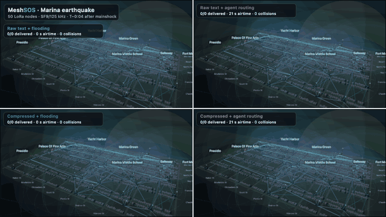
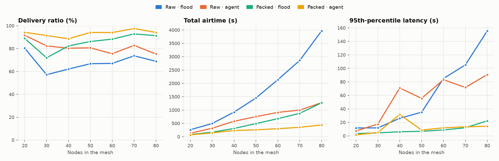
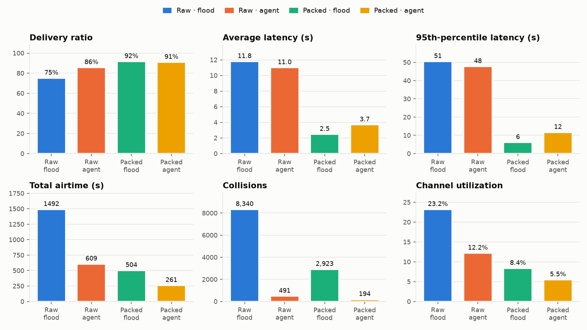
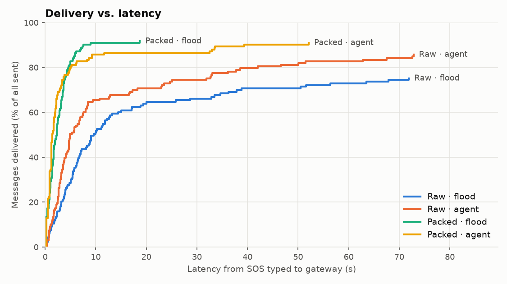
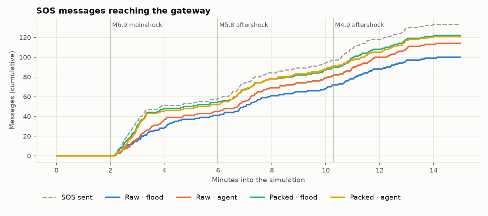
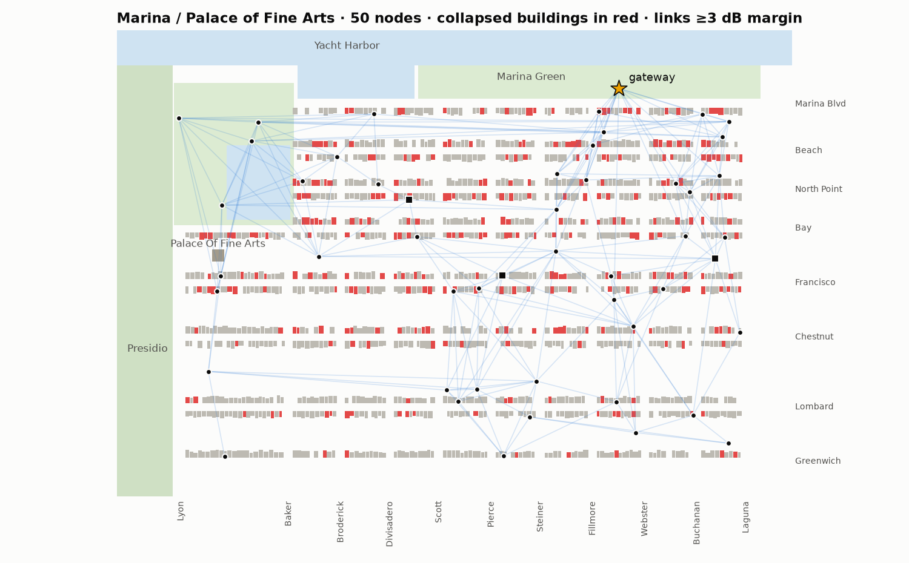
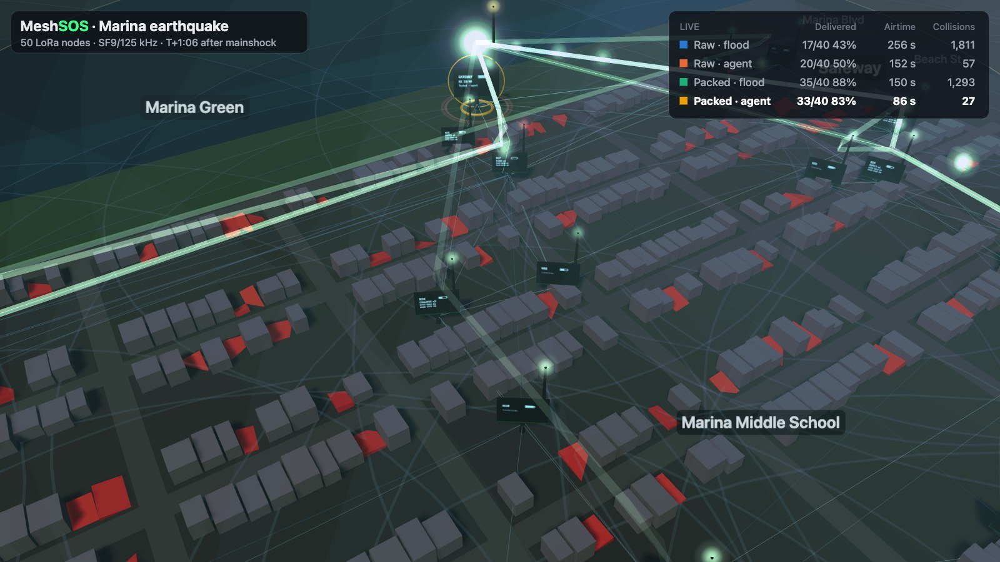
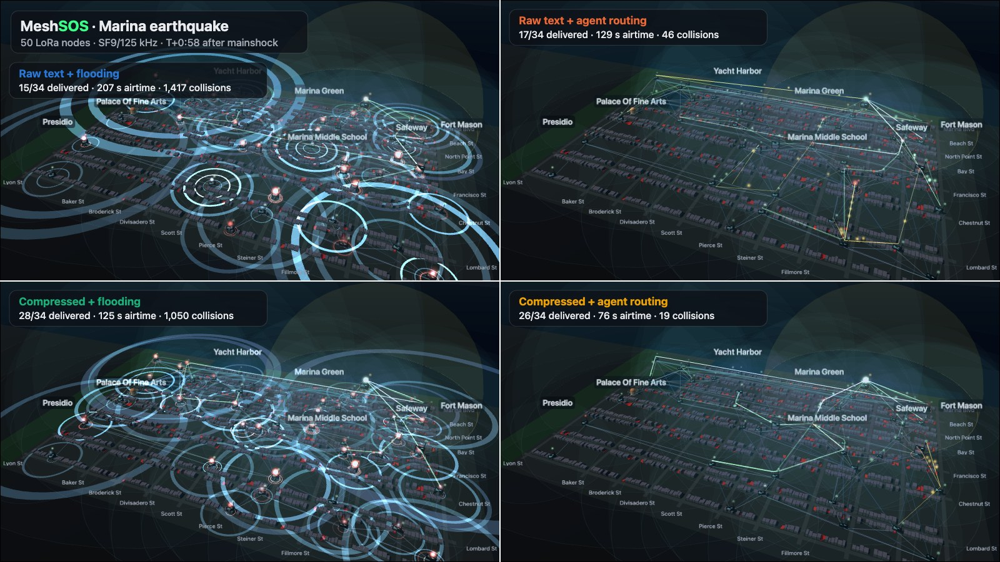

# MeshSOS

**AI-compressed distress messaging over a LoRa mesh** · Cal Hacks 13.0

After a big earthquake the cell network is the first thing to go, and everyone tries to call for help at once.
MeshSOS gives survivors cheap ESP32 LoRa radios that form a mesh back to a relief gateway. Every node runs a
small on-device agent that does two jobs. First, it **compresses** a free-text SOS like *"trapped under debris at 3rd
and Bay, 2 kids, one bleeding badly, need water"* into a **10-byte bit-packed packet** (type, severity, head count,
injuries, needs, hazards, location cell, ID), 7× smaller than the text. Second, it **routes** that packet
hop by hop to the neighbor with the best mix of link quality, progress toward the gateway, battery and idle
channel, instead of flooding it to everyone. We simulate a quake in San Francisco's Marina district (the
neighborhood that liquefied in 1989) with 30–80 nodes. In that model, compression plus agent routing delivers **89–98% of SOS messages**, and at 80 nodes it uses
**9× less airtime and 60× fewer collisions** than raw text over Meshtastic-style flooding.



## Results

**50 nodes, seed 1** (`python -m meshsos run --scenario quake --nodes 50 --seed 1`): 133 SOS messages over 15 simulated
minutes, a mainshock plus two aftershocks, 267 building collapses and 19 node failures. SF9 / 125 kHz, US915.

| Variant | Delivery | Latency avg | Latency p95 | Airtime | Collisions | Channel util. | Payload bytes/msg |
|---|---|---|---|---|---|---|---|
| Raw text + flooding | 75.2% | 11.8 s | 50.5 s | 1492 s | 8,340 | 23.2% | 69.7 |
| Raw text + agent routing | 85.7% | 11.0 s | 47.8 s | 609 s | 491 | 12.2% | 69.7 |
| Compressed + flooding | 91.7% | 2.5 s | 6.2 s | 504 s | 2,923 | 8.4% | 10.0 |
| Compressed + agent routing | 91.0% | 3.7 s | 11.7 s | **261 s** | **194** | **5.5%** | 10.0 |

A single seed is noisy (here packed flooding ties packed agent routing on delivery). The sweep below averages
**5 seeds per node count** and is the headline:

| Nodes | Raw + flood | Raw + agent | Packed + flood | **Packed + agent** | Airtime, raw + flood → packed + agent |
|---:|---:|---:|---:|---:|---:|
| 20 | 80.4% | 91.7% | 88.9% | **94.2%** | 261 s → 69 s |
| 30 | 57.2% | 82.3% | 71.9% | **91.4%** | 495 s → 143 s |
| 40 | 62.1% | 80.3% | 82.3% | **88.6%** | 923 s → 234 s |
| 50 | 66.8% | 80.7% | 86.2% | **94.1%** | 1,452 s → 258 s |
| 60 | 67.0% | 75.5% | 88.3% | **94.0%** | 2,138 s → 301 s |
| 70 | 73.7% | 82.8% | 92.8% | **97.5%** | 2,860 s → 352 s |
| 80 | 68.9% | 75.2% | 91.3% | **94.1%** | 3,966 s → 441 s |



**Where flooding falls apart.** Flooding's airtime grows with the square of the node count, since every message is
rebroadcast by nearly every node. By **50–60 nodes**, raw-text flooding puts more than 1,400–2,100 s of airtime on the
air inside a 900 s window, and p95 latency jumps from ~35 s to 85 s and then to 155 s at 80 nodes. Only spatial reuse keeps
it going at all. Compression is the biggest single win. A packed SOS is one 18-byte frame (~185 ms) instead of 2–3 raw-text fragments
(at SF9 the 400 ms dwell limit caps a frame at 66 bytes, and losing any one fragment loses the message), so each message
needs ~3× less airtime. Agent routing then cuts what is left by another 2–3×. Packed flooding still delivers well at 80
nodes, but it uses 3× the airtime and 24× the collisions of packed agent routing, so it is the next to break as traffic grows.

| | |
|---|---|
|  |  |
|  |  |

The on-node compressor recovers message type 99%, head count 100%, injuries 98%, needs 97% and location 100% of the
time on this run's messages. Read the limitations below before quoting those numbers.

## Run it

Python 3.10+, with only `numpy` and `matplotlib` at runtime.

```bash
python -m venv .venv && source .venv/bin/activate
```

```bash
pip install -r requirements.txt pytest
```

```bash
python -m meshsos run --scenario quake --nodes 50 --seed 1
```

This prints the results table and writes `runs/<id>/` (`timeline.json`, `results.json`, `results.md`, `metrics.png`,
`latency_cdf.png`, `delivery_over_time.png`, `map.png`), then points `runs/latest` at it. A run takes about 10 s.

```bash
python -m meshsos sweep --seeds 5
```

```bash
python -m meshsos encode "trapped under debris at 3rd and Bay, 2 kids, one bleeding badly, need water"
```

```bash
python -m meshsos decode 471a0107017a40000000
```

```bash
pytest
```

The tests cover the packet encoder/decoder round trip, the Semtech airtime formula (including the 330 ms / 185 ms sanity
points), the dwell limit, capture, the full simulator, and a bit-exact check of the C++ firmware header, which is compiled
on the host.

`--sf 7..10` changes the spreading factor. SF11/12 are rejected because no frame fits inside 400 ms at 125 kHz.
`--llm` re-decodes a few delivered packets with Claude at the gateway (needs `ANTHROPIC_API_KEY`).
In code, `codec.decode(packet, llm=fn)` accepts any `str -> str` callable. The radio path never depends on it, and it
falls back to the rule-based text on any error.

### 3D viewer

```bash
python -m meshsos view --run runs/latest
```

This starts a local server and opens the browser. It is a single `viewer/index.html` with Three.js `0.160.0` from a CDN
and no build step. You can also view the bundled sample run without running anything:
`python -m meshsos view --run examples/quake_n50_s1_sf9`.

* **Scene**: the Marina / Palace of Fine Arts street grid with box buildings. Buildings that collapse sink, tilt and turn
  red. Each ESP32 node is a small board with an antenna and a live OLED face (node ID, battery, last compressed packet in
  hex, or raw text in the raw-text runs). The gateway has a gold ring; T-Deck terminals are larger and have a keyboard.
  Faint domes show each node's typical link range. Dead nodes go dark and fall over.
* **Packets**: green pulses are packets of messages that reached the gateway, amber pulses are packets still in flight or
  lost, blue rings are flood rebroadcasts, red flashes are collisions, and a green trail shows each delivered message's path.
* **Controls**: orbit camera, play/pause, time slider (red ticks mark shocks), speed. Switch variants with `1`–`4`
  or show all four at once with the **2×2** compare (`Q`). The live scoreboard tracks delivery, airtime and collisions.
* **Click a node** to see its raw SOS next to the 10-byte packet in hex, the decoded fields, the gateway's decode, its
  neighbor scores (agent runs) and its current route to the gateway, highlighted in 3D.
* **Demo mode**: `python -m meshsos view --demo` (or add `&demo=1` to the URL) auto-plays the quake in 2×2 with a slow
  camera fly-through, and loops. Use this one for the judges.




The screenshots and GIF come from the viewer's capture mode (`&capture=1`, which steps time deterministically and posts
frames to the local server). `scripts/make_gif.py` lists the exact URLs.

## How it works

**Radio model** (`meshsos/radio.py`, `channel.py`). The path loss model is log-distance (exponent 3.4 at body height in
a 2–4 storey neighborhood) plus 6 dB per intact building and 11 dB per collapsed one crossed (segment-vs-box
intersection over ~1,200 buildings), with log-normal shadowing (σ 4 dB) and per-packet fading (σ 2 dB). LoRa
time-on-air uses the Semtech formula (SF7–12, 125 kHz, CR 4/5, 8-symbol preamble, explicit header, CRC, low-data-rate
optimization automatic at SF11+). Sensitivity is thermal noise + 6 dB NF + the SX1276 per-SF SNR floor. A receiver keeps
a frame only if it beats the summed overlapping interference by **6 dB (capture effect)**. Radios are half-duplex and
listen before talking (CAD). Every frame is checked against the **400 ms US915 dwell limit**; raw text that doesn't fit is
fragmented.

**Scenario** (`scenario.py`). A seeded M6.9 mainshock and two aftershocks. Buildings on bay fill (north of Chestnut)
collapse at ~3× the rate of the rest, devices inside collapsed buildings sometimes die, nodes fail at random, and
low-battery nodes drain out. Survivors send SOS messages in bursts after each shock, plus a trickle of follow-ups. The
messages come from a template corpus of trapped/medical/fire/gas/flood/supply/check-in texts with typos, shouting and
off-map places ("3rd and Bay"). All four variants run on exactly the same events.

**Compression** (`codec.py`). The rules are regex/keyword based, so the C++ version fits on an ESP32 in a few KB:

```
version 2 | type 4 | severity 2 | people 5 | kids 3 | injuries 8 | needs 8 |
hazards 4 | floor 3 | loc_src 1 | cell_x 6 | cell_y 5 | minute 8 | msg_id 16   = 75 bits → 10 bytes
```

Location comes from a gazetteer of Marina streets and landmarks ("Fillmore and Chestnut", "the Safeway"). When the text
names nowhere known, it falls back to the node's own GPS cell (64 × 32 grid, ~30 × 42 m cells). The gateway rebuilds a
dispatch line: `[TRAPPED sev 3/3] · 3 people (2 children) · near Scott St & Bay St [cell 30,18] · injuries: bleeding ·
needs: rescue, medic, water · T+7 min · #1234`.

**Agent routing** (`sim.py`). Each node keeps an EWMA of RSSI/SNR and ACK success per neighbor, learns hop counts
from beacons and from metrics piggybacked on every header (split horizon, 15-hop cap), and scores each neighbor:

```
score = 0.40 · link (SNR margin × ACK rate) + 0.30 · progress to gateway + 0.15 · battery + 0.15 · (1 − channel busy)
```

It unicasts to the best neighbor with a link-layer ACK. After two missed ACKs it fails over to the next best, and it holds
the packet (store and forward) when no route exists. A 4-bit gradient in the header must strictly decrease every hop
(with at most two sideways moves), which makes forwarding loop-free. Beacons are skipped when recent traffic already
carried the metrics. The agent's header is 4 bytes larger and all of its beacons and ACKs count toward its airtime.

**Baseline: Meshtastic-style managed flooding.** Every node that hears a new packet rebroadcasts it after an
SNR-weighted contention delay (weak receivers go first, as in Meshtastic), and cancels its own rebroadcast if it hears
someone else's first. Hop limit is 7 (Meshtastic's maximum, since the default of 3 can't cross this map). The gateway
doesn't rebroadcast. Neither mode retransmits end to end.

**Metrics.** Delivery is the share of all SOS messages fully reassembled at the gateway. Latency runs from the SOS being
typed to delivery. Airtime is the sum of every transmission, including beacons and ACKs. A collision is a frame lost to
interference at an intended receiver: any neighbor for a broadcast, the next hop for a unicast. Channel utilization is
the mean fraction of time each node hears the channel busy.

## How this maps to real hardware

| Sim | Hardware |
|---|---|
| Field node, 17 dBm, 0 dBi, sensitivity −129.5 dBm at SF9 | **LilyGO T3 LoRa32 V1.6.1**: ESP32 + SX1276 at 915 MHz, 0.96" SSD1306 OLED (the viewer's OLED faces are this screen) |
| T-Deck node, 20 dBm | **LilyGO T-Deck Plus**: ESP32-S3 + SX1262 with keyboard and screen, so responders can type and read SOS traffic in the field |
| Gateway, 20 dBm + 3 dBi on a 6 m mast | An SX1262 board on a mast at the Marina Green staging area, with WiFi/Ethernet/satellite backhaul. This is where the optional LLM decoder runs. |
| `codec.py` | [`firmware/meshsos_codec.h`](firmware/meshsos_codec.h): a header-only C++17 port (no heap, no STL) with a bit-exact packer, `strstr` keyword encoder, airtime helper and a RadioLib example for the T3's pins. `tests/test_firmware_compat.py` compiles it and compares it against Python. |
| 400 ms dwell check | US915 rules cap each transmission at 400 ms. The sim enforces that on every frame but models a single channel; a field deployment would also hop channels the way LoRaWAN US915 does. |
| Battery drain | Deliberately exaggerated so a 15-minute run shows what hours of operation do to low-battery nodes. |

**Spectrum check at the venue:** our Flipper Zero Frequency Analyzer scans at Cal Hacks found no strong 900 MHz activity
nearby, so the 915 MHz band was clear for the demo boards.

## Limitations

* The SOS corpus is synthetic, and the keyword rules and the templates were written by the same people, so the 97–100%
  field accuracy is optimistic. Real survivor text will be messier; the LLM hook at the gateway is there for that.
* The street grid is approximate (good to a few tens of metres), and the propagation constants were tuned to give a
  plausible 4–6 hop mesh, not fitted to measurements.
* Single runs vary a lot with the seed. Use the sweep averages to compare variants.

## Layout

```
meshsos/      radio.py · channel.py · geo.py · scenario.py · codec.py · sim.py · experiments.py · plots.py · server.py · cli.py
viewer/       index.html (Three.js 0.160.0, single file)
firmware/     meshsos_codec.h
tests/        test_codec.py · test_airtime.py · test_sim.py · test_firmware_compat.py
examples/     a sample timeline.json for the viewer
docs/         charts, screenshots, GIF
```
